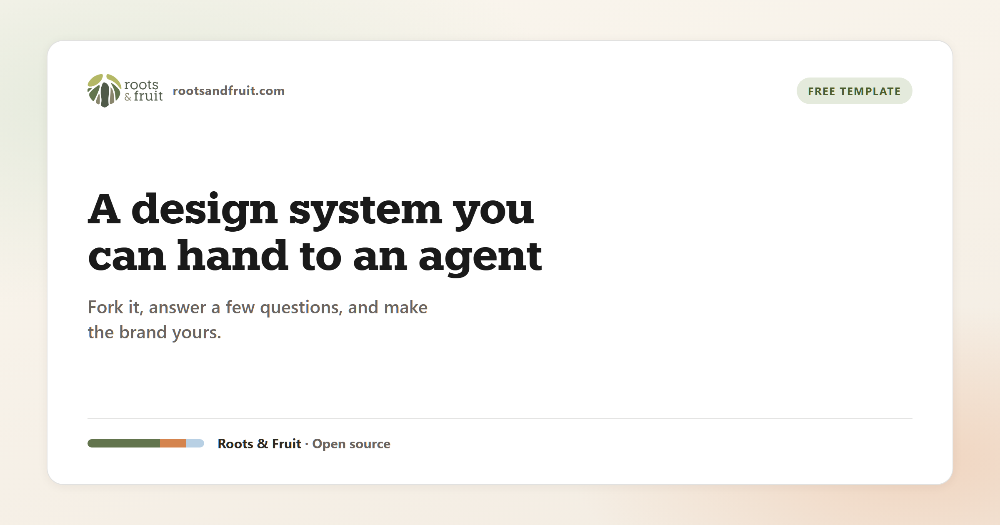

# Design System Template

[](LICENSE)
[](https://github.com/Roots-and-Fruit/design-system-template/generate)
[](https://roots-and-fruit.github.io/design-system-template/)
[](CUSTOMIZE.md)

<p align="center">
  
</p>

Most brand kits I see are a PDF and a folder of logos. They look fine in a deck. The moment you ask an agent to build a page, none of that is in the prompt, so it picks its own colors, its own type, and its own buttons.

This repo is the thing you fork instead. It is already a working design system, with a placeholder called Example Brand so you can click through it before you change anything. You answer a few questions. Your agent writes your name, colors, and fonts into one file, runs one command, and the reference site becomes yours. After that, `DESIGN.md` is the contract your agent is supposed to follow, so the next screen stays on brand.

If you publish with WordPress, that same command compiles a block theme. The editor gets your colors, your type, and a set of sections. You are not keeping a second brand up to date by hand in `theme.json`.

Already sure you want it? [Use this template](https://github.com/Roots-and-Fruit/design-system-template/generate), open the new repo in your agent, and paste this:

```text
Walk me through this project's customization checklist
```

## What you get out of the fork

You get a system that looks finished on day one, before you have made a single decision. Colors, type, buttons, forms, and page sections are already there. Example Brand is only a stand-in. The brand you end up with is yours.

You get a short written contract, `DESIGN.md`, that an agent can actually read. It says which colors do which jobs, how type should scale, and what the brand should never look like. When someone (or some agent) asks for a new page, that file wins over taste.

You get token names that survive a rebrand. `--cds-primary` stays `--cds-primary`. A new palette changes the value, not every class in the project.

You get one stylesheet you can drop into a site that is not WordPress. And if you do use WordPress, you get a theme compiled from that same contract, so the marketing page and the editor are the same system.

## How to hand it to your agent

You do not have to learn the checklist first. The prompt above is the whole start. The checklist your agent follows is [`CUSTOMIZE.md`](CUSTOMIZE.md). If it wanders off, point it at [`AGENTS.md`](AGENTS.md). Customizing a fork is Job B in that file. Building a new screen with the finished system is Job A, and Job A starts by reading `DESIGN.md`.

The agent should ask you, in order, and wait for real answers:

1. Logos, if you have them. Put the files in `assets/` (a square mark, and wordmarks for light, dark, and one-color use). If you only have a PNG or a PDF, say so. Do not let it invent a logo.
2. The brand name, who it is for, and how it should feel. One or two sentences is enough. Include what it must never look like, if you know.
3. Colors. Hex values if you have them, with roles if you know them (primary, accent, page background, body text). If you do not have a palette, give it a vibe and one color you refuse to give up.
4. Fonts. Your families, or keep the demo pairing, or ask for two open alternatives that match the feel. Licensed fonts should not go into a public repo.

Then it writes those answers into [`brand.json`](brand.json), turns the placeholder flag off, and runs:

```bash
npm run customize
```

That fills the color and type tokens, updates the font import, stamps your name through the reference pages, and refreshes the front of `DESIGN.md`. It also compiles the WordPress theme. After that, the agent rewrites the prose in `DESIGN.md` so it stops describing Example Brand. The front-matter blocks the script owns (name, colors, type, radii) should be left alone. Prose underneath is the part that should sound like you.

Open the reference site when it is done. The sidebar should show your name. The color chips and the type should match what you said. You need Node 18 or newer for that command. You do not need a build step just to look at the HTML.

## WordPress comes out of the same files

`DESIGN.md` and `css/tokens.css` stay the source of truth. The compiler writes a thin block theme to `wordpress/cds/`. [`WORDPRESS.md`](WORDPRESS.md) is the contract for that projection. If your agent is doing theme work, tell it to open that file. In [`AGENTS.md`](AGENTS.md) that work is Job D.

`npm run customize` already runs the compiler. If you changed tokens or the contract and only want the theme refreshed:

```bash
npm run compile:wordpress
```

Copy the theme into a WordPress install when you are ready to see it in the editor:

```bash
node scripts/sync-theme.mjs --dest "C:/path/to/wp-content/themes/<slug>"
```

The install slug comes from your brand name after compile. Example Brand installs as `example-brand`.

In the inserter, sections show up in a group named after the brand: hero, proof, cards, split, quote, a dark band, a call to action, and an alert. There are page recipes for an article and a landing. Buttons have secondary, outline, accent, and ghost styles. Group styles cover the kit's layout jobs (Copy, Cluster, Switcher, Sidebar, Center, Box) plus a few surface paints. A two-column marketing band uses Switcher. It does not use Core Columns for that job.

Do not edit the generated `theme.json` by hand. Change the kit, then compile again.

## Drop the CSS into something else

```html
<link rel="stylesheet" href="css/cds.css">
```

That one link loads fonts, tokens, element styles, layout primitives, and components. If the site already styles headings and links, import `tokens.css`, `layouts.css`, and `components.css`, and leave out `base.css`. `base.css` is the only file that styles bare tags.

`css/kit.css` is the chrome for these reference pages. It is not part of the system you ship.

## Look at it before you change anything

[Start](https://roots-and-fruit.github.io/design-system-template/) · [Showcase](https://roots-and-fruit.github.io/design-system-template/showcase.html) · [The site](https://roots-and-fruit.github.io/design-system-template/the-site.html) · [Make it your own](https://roots-and-fruit.github.io/design-system-template/customize.html)

Or from the folder:

```bash
npx --yes serve .
```

Serving it also turns on smooth page transitions in browsers that support them.

The sidebar walk is Overview, Brand and assets, Tokens, Components, Patterns and layout, Showcase, then `DESIGN.md`. Showcase is four assembled pages on the same classes: a landing, a plugin page, an article, and a tool.

## License and credit

MIT. Free to use and change. The brand you build with it is yours.

The sidebar includes a small Roots & Fruit credit so other people can find the kit. Leaving it is appreciated. If it does not fit the site you are building, take it out. A shout-out on social instead is genuinely welcome.

I maintain this as [Roots & Fruit](https://rootsandfruit.com).
